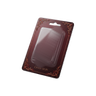
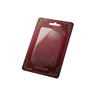
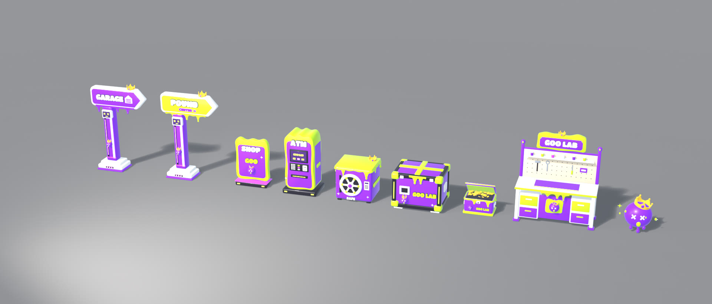
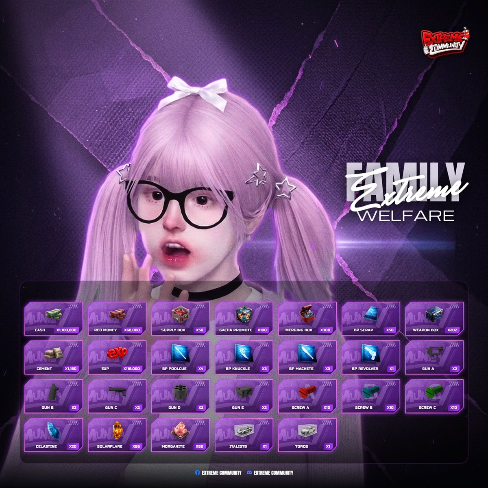
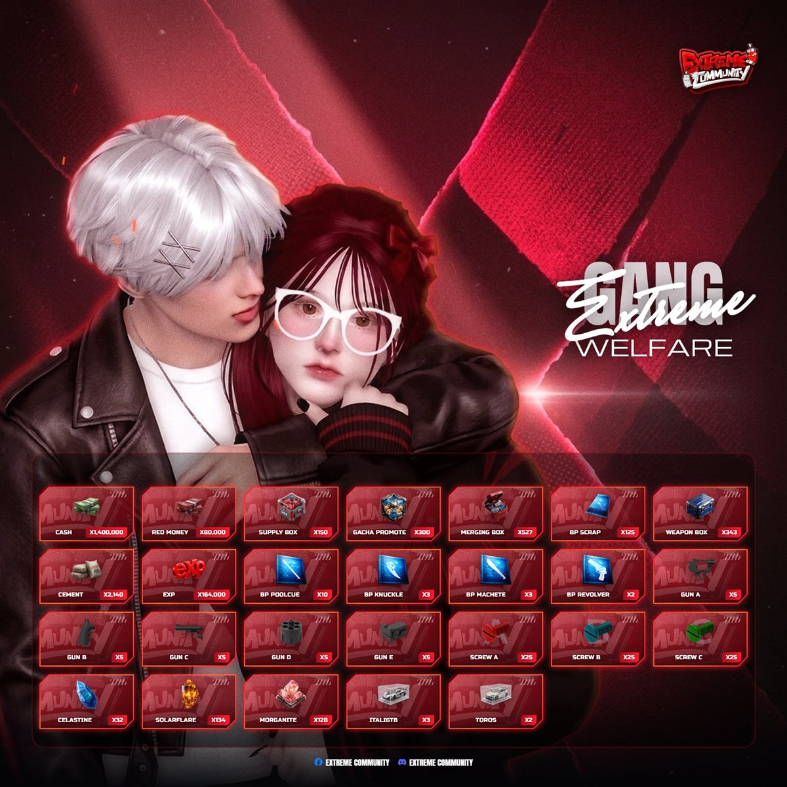

# infrontofx-skill

An all-in-one agent skill pack for a FiveM roleplay server (`1nfx_*` resources). It covers writing Lua and NUI/DUI code, building weapon skins, building branded props, and making support posters. It works with Claude Code, Google Antigravity, Codex and other agents that read `SKILL.md` files.

The root `SKILL.md` holds a routing table, so an agent opens only the files a task needs.

| Category | What it does | Start here |
| --- | --- | --- |
| [Coding](#coding) | Write, rewrite, review and optimize Lua 5.4 resources and NUI/DUI pages to the house standard | `SKILL.md` |
| [Weapon modeling](#weapon-modeling) | Weapon skin sets: Blender models, `.ydr`/`.ytd`, custom particles (`.ypt`), hit/kill screens and sounds | `weapon-forge/SKILL.md` |
| [Prop modeling](#prop-modeling) | Branded toy-style props: signs, ATM, safe, crates, loot chest, crafting bench, floating marker | `prop-forge/SKILL.md` |
| [Posters](#posters) | Support / welfare / giveaway posters from character art, item icons and a logo | `poster-forge/SKILL.md` |

## Install

Clone into your project's skills folder:

```bash
git clone https://github.com/baespy/infrontofx-skill.git .claude/skills/infrontofx
```

Or add it as a Claude Code plugin (not yet tested end to end):

```text
/plugin marketplace add baespy/infrontofx-skill
/plugin install infrontofx-skill@infrontofx
```

For Google Antigravity, `weapon-forge/scripts/sync-antigravity.ps1` and `prop-forge/scripts/sync-antigravity.ps1` copy each forge into the workspace's `.agents/skills/<name>/`. Always edit the `.claude/skills` copy and sync afterwards. Do not edit the `.agents` copy.

---

## Coding

The house standard for FiveM Lua and NUI/DUI. The goal: every resource behaves exactly as before, with shorter, faster code and no duplication.

**Rules in brief**

- OOP only: one module table per side, every function is a method, no file-level `local function`, no file-level constants
- No comments in shipped code (Lua, JS, CSS, HTML)
- No `FC` adapter table and no `config/function/` folder; integrations live in `core/` as methods
- `@1nfx_lib/init.lua` is the shared runtime (points, zones, cache, spawn, callbacks, streaming loaders with timeouts)
- The server decides every value (items, money, prices, cooldowns, distance) and validates and throttles every payload
- Clean up everything in `onResourceStop` and `playerDropped`; secrets stay server-side

**What is inside**

| Path | Contents |
| --- | --- |
| `SKILL.md` | Routing table, principles and owner instructions |
| `skills/common/` | Style, architecture, config, core API, events, runtime, security, performance, networking, database, natives, 1nfx_lib, debugging |
| `skills/ui/`, `NUI_DUI.md` | NUI bridge, 1nfx design system, vanilla, React/Vite, Vue/Svelte, DUI |
| `references/` | Core (ESX-compatible) API, pNotify, infrontofx FiveM notes |
| `rules/contracts.md` | Cross-resource contracts |
| `memory/` | Gotchas and research learned on the live server (each entry has a date and game build) |
| `checklists/` | New-resource and review checklists |
| `templates/resource/` | A reference resource that passes the linter |
| `TOOLING.md` | Token-saving workflow, cross-session memory, MCP notes |

**Tools** (Node 22+)

```bash
node scripts/lint-resource.mjs <resource-folder>
node scripts/new-resource.mjs <name> --destination <path>
node scripts/validate-skill.mjs
```

The linter checks for comments, balanced blocks, `FC` usage, file-level `local function` and constants, undeclared `scriptname`, string-built SQL, hard-coded webhooks, NUI callbacks that never call `cb`, and manifest problems.

---

## Weapon modeling

`weapon-forge/` builds a complete weapon skin set from one JSON spec: models, textures, icons, original particles, full-screen hit/kill overlays, sounds and the integration files for `1nfx_weaponskin`.

 

| Area | Highlights |
| --- | --- |
| Style | 21 style families with composition rules; describe a new style from a reference image on 5 axes |
| Modeling | `forge_weapon.py` builds 7 weapon slots in 20+ styles; `split_ai_set.py` and `import_ai_model.py` turn Tripo/Meshy/Hunyuan models into proper weapon slots |
| Export | `export_ydr.py` writes `.ydr` (RSC7), `.ytd` and DXT5 `.dds` without Sollumz; `inspect-ydr.ps1` checks the binary |
| Particles | `ptfx.ps1` builds original `.ypt` files from a design: 27 themes, 82 sprites, 69 layer recipes, lint and preview renders |
| Screen & sound | 17 full-screen overlay styles and 18 synthesized sounds |
| Safety gate | Bone contract, `(0,0,0)` effect guard and streaming-release rules in `weapon-forge/references/bone-and-memory-safety.md` |
| Antigravity | Blender MCP (26 tools) workflow in `weapon-forge/references/antigravity.md` |

Needs Blender 4.2+, Windows PowerShell 5.1 and .NET (bundled with Windows). Run `weapon-forge/scripts/doctor.ps1` to check the machine.

---

## Prop modeling

`prop-forge/` builds a set of server props that share one brand: one palette, a mascot, crowns, dripping slime and sticker-style wordmarks. One JSON spec drives the whole set. Each prop is generated in Blender from bevelled primitives and joined into one mesh, with its origin at floor centre and its front facing -Y. Each prop comes out with collision boxes and a triangle report, and every prop in the set shares one 256x256 palette texture.



*The example set "GOO LAB" (an original brand), rendered by `forge_prop.py` in Blender. These are Blender renders, not in-game screenshots.*

| Archetype | In-game use | Default size (m) | Triangle budget |
| --- | --- | --- | --- |
| `sign_post` | Garage / impound point, arrow sign | 1.67 x 0.58 x 2.55 | 14k |
| `kiosk_sign` | Shop sign | 0.96 x 0.44 x 1.35 | 11k |
| `atm` | ATM | 0.96 x 0.77 x 1.71 | 12k |
| `safe` | Safe / house storage | 1.10 x 1.02 x 1.11 | 14k |
| `crate` | Stash, airdrop, reward box | 1.34 x 1.17 x 1.03 | 12k |
| `chest` | Open loot chest with coins | 0.81 x 0.61 x 0.80 | 10k |
| `workbench` | Crafting bench with tool board | 2.02 x 0.92 x 2.26 | 18k |
| `mascot_marker` | Floating marker above an interaction point | 1.00 x 0.64 x 0.91 | 5k |

**Workflow**

```powershell
$blender = 'C:\Tools\blender-4.2.3-windows-x64\blender.exe'
& $blender -b --factory-startup -P prop-forge\scripts\blender\forge_prop.py -- --spec props.json --out build --lineup
& $blender -b --factory-startup -P prop-forge\scripts\blender\validate_prop.py -- --blend build
& $blender -b -P prop-forge\scripts\blender\export_prop.py -- --blend build --out stream --format cwxml
```

Export needs the Sollumz 2.9+ extension with its szio dependency. Run it without `--factory-startup` so the extension loads. `--format native` writes binary `.ydr`/`.ytyp` directly but also needs Sollumz's optional PyMateria package, which has its own licence agreement. `--format cwxml` writes CodeWalker XML that CodeWalker converts to binary.

1. Copy `prop-forge/templates/prop-spec.example.json` and set the brand, the palette and the list of props
2. Build, then look at `lineup.png` and every `<id>_preview.png`; rebuild single props with `--only <id>`
3. Add AI-generated sticker art as decals when geometry is not enough (uses the poster-forge image scripts)
4. Run `validate_prop.py` until it reports `fail=0`
5. Run `export_prop.py`, which drives Sollumz to write one `.ydr` (texture and collision embedded) and one `.ytyp` per prop, then stream them from a prop resource
6. Spawn props with `lib.spawn.pointProp`, which creates them near the player and releases them when the player leaves

**References:** style DNA and look checklist (`prop-forge/references/style-toybrand.md`), archetypes and how to add one (`prop-forge/references/archetypes.md`), finishes, decals, collision, LOD and Sollumz export (`prop-forge/references/pipeline.md`), Antigravity and Blender MCP (`prop-forge/references/antigravity.md`), resource and spawn code (`prop-forge/references/integration.md`).

**Status:** tested on Blender 4.2.3 with Sollumz 2.9.1. All 9 example props build, validate with `fail=0` and export as native binary `.ydr`/`.ytyp` (RSC7). A re-import in Sollumz shows the mesh, the shaders, the embedded texture and the collision. Loading the props in game is not tested yet.

---

## Posters

`poster-forge/` makes support, welfare and giveaway posters for gangs, families, ladies, newcomers and streamers. It takes character art, item icons and a logo. Two approved styles are supported: (A) a large dark character face with film grain and (B) a character pointing a gun at the camera.

 

| Area | Highlights |
| --- | --- |
| Character art | Green-screen characters generated with Antigravity (`agy-gen.ps1`) or Codex (`codex-gen.ps1`), then cut out, hole-filled and upscaled |
| Layout | HTML/CSS poster engine rendered to PNG, with templates for each tier and for square and wide formats |
| Prompts | Prompt sets that turn a character into semi-realistic AAA 3D art or change its pose to match a reference |

The fonts are OFL (see `poster-forge/engine/fonts/NOTICE.md`). Reference images of other people are not included in the repo.

---

## Notes

- Never commit secrets (webhooks, tokens, passwords).
- Style references from other creators are used for direction only; never copy their names, logos, mascots, models or textures.
- Escrowed resources (`.fxap`) are never decrypted or edited.

## License

MIT
